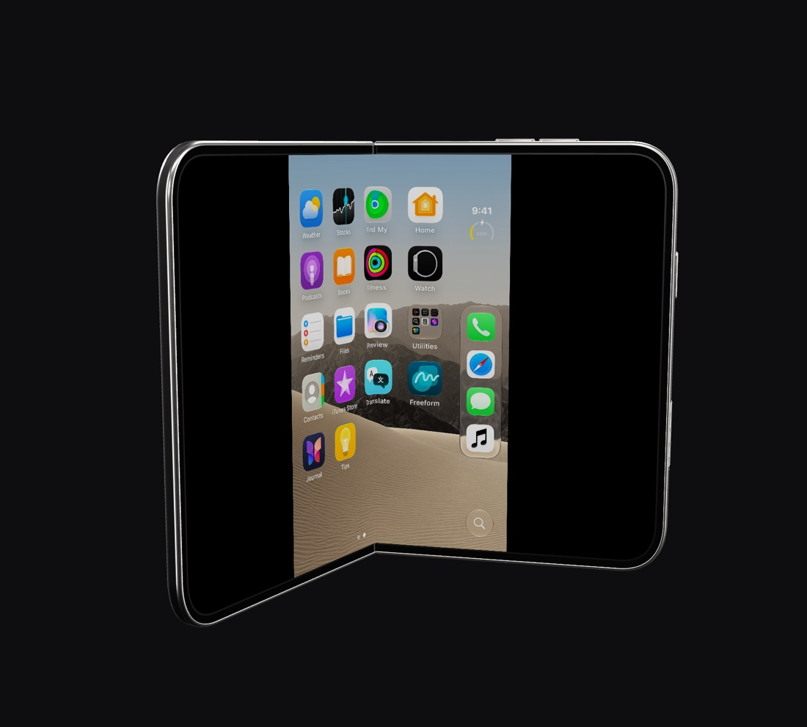
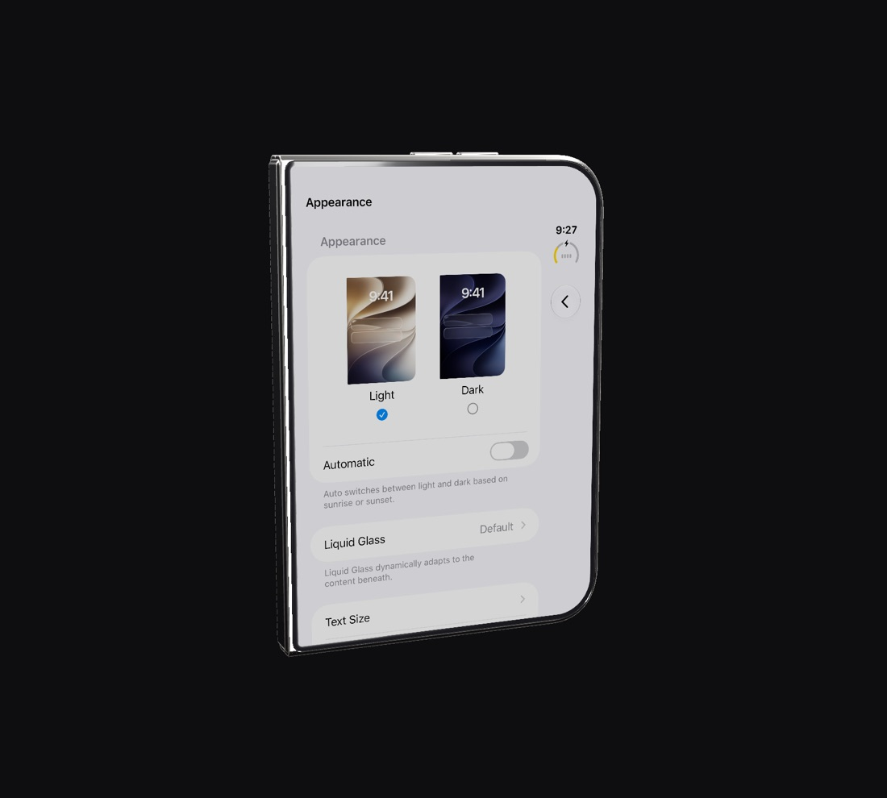
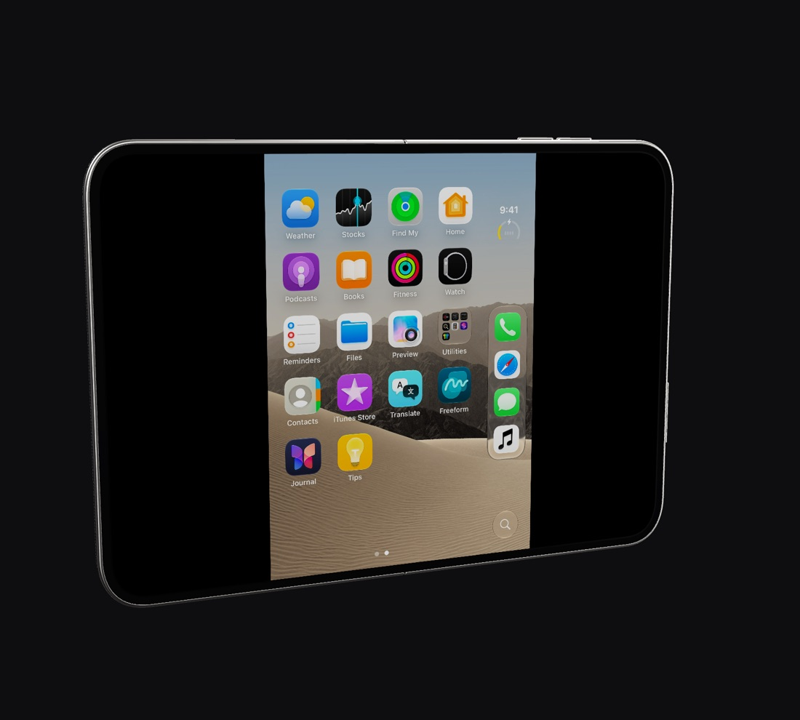
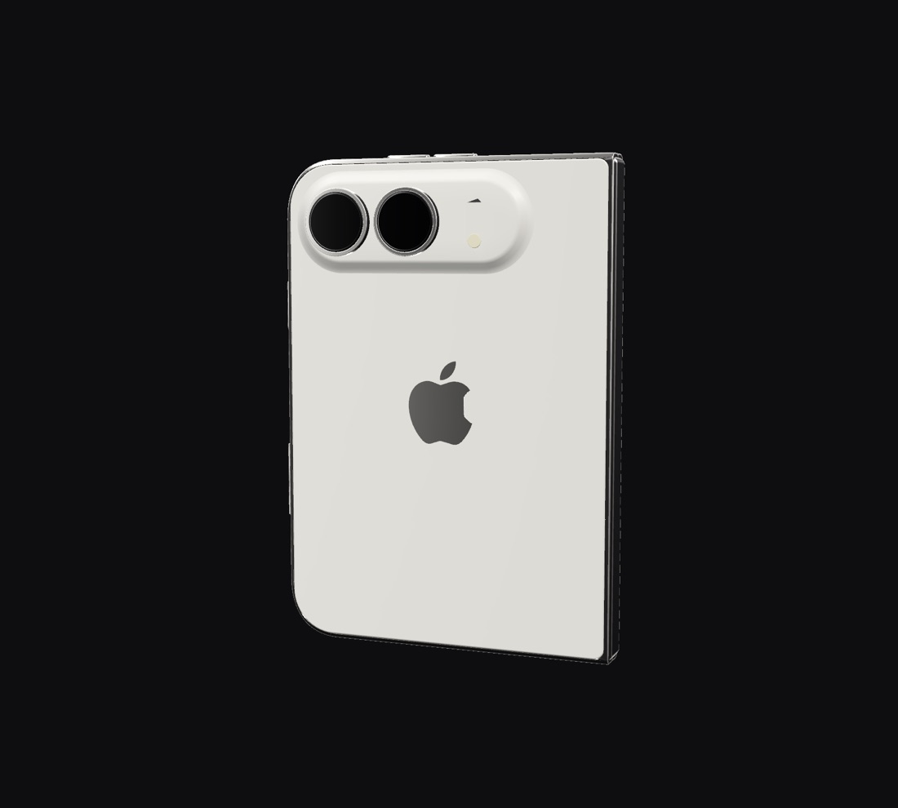
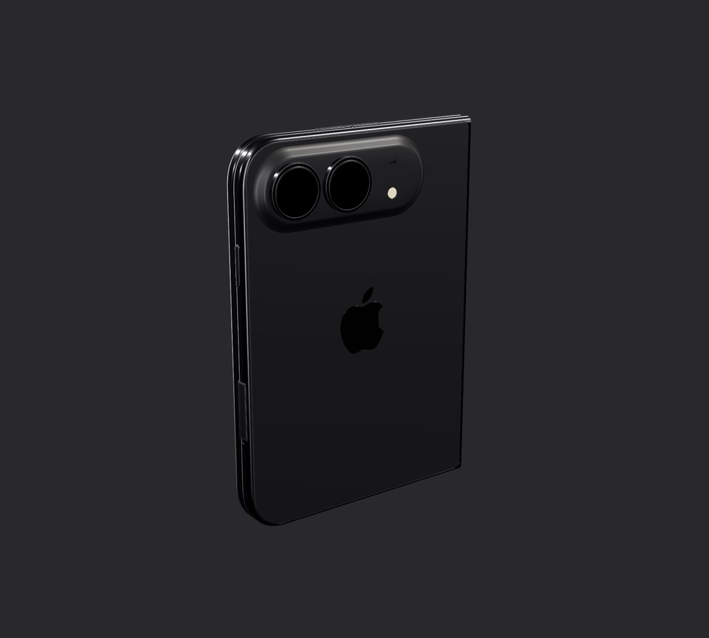

# iPhone Duo

This fork runs iOS 27.2 for the iPhone Duo (`iPhone19,4`, Apple's book-style
foldable) and shows it as a 3D phone you can fold, turn and press.



## What you get

- **A real Duo guest.** The VM restores the Duo's own iOS build and reports
  itself as `iPhone19,4`, so iOS takes its foldable code paths.
- **A hinge sensor iOS reads.** `libvphonehinge.dylib` runs in `backboardd`
  and publishes the HID service a Duo's hinge does: usage page `0xFF0C`,
  usage `0x21`, hinge-angle events (type `0x2C`). The angle you set is the
  angle iOS reads, to the hundredth of a degree: 0° closed, 180° open flat.
- **A 3D window.** The phone is drawn with RealityKit under a studio light
  probe: polished titanium around matte Star White glass, or Space Black.
  - Drag the phone or the backdrop to turn it. Pinch, or scroll off the
    screen, to zoom.
  - Click the lit screen to touch iOS at that point, from any angle and at
    any fold. A two-finger scroll that starts on the screen drags in iOS.
  - Click a key on the frame to press it. Each key clicks with its own
    sound, ticks the trackpad and sinks 0.3 mm into the frame while held.
  - The **Fold** slider sets the hinge and shows the exact angle; beside it,
    **iOS 87.5°** is what the guest's sensor publishes, read back after each
    change.
  - Drop an `.ipa` on the phone to install it; any other file goes to the
    Files app.
- **A Fold menu.** Control-Command-1 to 4 fold to Closed (0°), Tent (70°),
  Laptop (110°) and Open Flat (180°); Control-Command-0 turns the view to
  the lit screen. Star White and Space Black are there too.
- **Scripting.** The fold, the keys and the finish can be driven from the
  host socket or `scripts/duo/vphone-duo`; see [Scripting](#scripting).

| | |
| --- | --- |
|  |  |
|  |  |

## One display, two panels

Apple's Virtualization.framework gives a VM at most one display
(`VZMacGraphicsDeviceConfiguration._maximumAllowedDisplayCount` is 1), so the
VM cannot have the Duo's two physical panels. The window lights one at a
time, as the phone does:

| Hinge | Lit panel |
| --- | --- |
| opened past 95° | inner, 1878 × 2670 at 430 ppi |
| closed below 60° | outer, 1398 × 2034 at 460 ppi |
| in between | whichever was lit, so a tent does not flicker |

iOS draws its outer-panel layout. On the inner panel, which is landscape
when open, that frame is shown at its own aspect ratio between black bars,
and touches on the bars are ignored. `VPHONE_DUO_RESIZE=1` also resizes the
guest display to the lit panel, for testing how an app takes a live display
change. `VPHONE_DUO_FLAT=1` shows the Duo in the plain window instead.

## Requirements

Everything vphone needs (see [Host Setup](host-setup.md)), plus:

- The Duo's iPhone IPSW (`iPhone19,4`, 27.2) and cloudOS 26.4 (23E5207q),
  the cloudOS vphone pairs every iPhone with.
- About 70 GB free while the VM is created; 64 GB of it stays as the disk.
- Any Apple Silicon Mac. The Duo's A20 Pro firmware uses the CSSC scalar
  instructions; `sysctl hw.optional.arm.FEAT_CSSC` says whether your Mac
  has them. Where it does not, the guest kernel emulates them. That works,
  but boots and app launches are slower.

## Create the VM

In Launchpad, choose **New Machine**, then **iPhone Duo** and **iOS 27.2**:
Launchpad downloads the IPSW from Apple. Or from the command line:

```sh
vphone-launchpad-cli vm create duo \
  --iphone-source ~/Downloads/iPhone19,4_27.2_24B91020_Restore.ipsw \
  --cloudos-source ~/Downloads/<cloudOS 26.4>.ipsw \
  --cpu 5 --memory 4608 --disk-size 64 --network nat --preset standard
vphone-launchpad-cli vm start duo
```

A Mac with 16 GB of memory runs it well with 5 CPUs and 4.5 GB; give it
more if you have it.

## Scripting

The VM's control socket (`~/.vphone/machines/duo/vphone.sock`) takes:

```json
{"t":"fold"}
{"t":"fold","angle":87.5}
{"t":"fold","posture":"laptop","animate":true}
{"t":"duo","button":"side","ms":800}
{"t":"duo","finish":"black"}
```

`scripts/duo/vphone-duo` wraps them:

```sh
scripts/duo/vphone-duo fold 87.5
scripts/duo/vphone-duo fold tent --animate
scripts/duo/vphone-duo press volume_up
scripts/duo/vphone-duo shot ~/Desktop/duo.png
```

A headless launch has no window, so `fold` goes straight to the hinge sensor.

### Touch marks

While a finger is down on the 3D screen, a grey, half-clear mark sits where
it touches, riding the screen as it folds, so a recording shows each touch.

## Working on the 3D window

`Tools/DuoPreview` builds the window without the VM engine, so a change to
the model, the fold or hit-testing can be checked without installing a
bundle. Its `live` script drives a running Duo through the socket and taps
Settings on the 3D model; see its README.

The model comes from `Tools/DuoModel/prepare_duo.py`, which turns the source
Blender scene into `DuoModel.usdz` with named parts, live panels and the
hinge rig; `render_previews.py` renders the studio light probe.

## iCloud

A research guest hides Apple Account sign-in, having no account. To sign in
to iCloud yourself:

```sh
scripts/duo/vphone-duo signin allow
```

then open **Settings ▸ Apple Account** and sign in. It applies to apps
launched after it; `signin block` hides sign-in again. Apple may still refuse
a virtual device: the VM has its own identity and never borrows a phone's.

## What it does not do

- **Two live panels at once.** See above.
- **Face ID.** The PCC research VM has no camera module.
