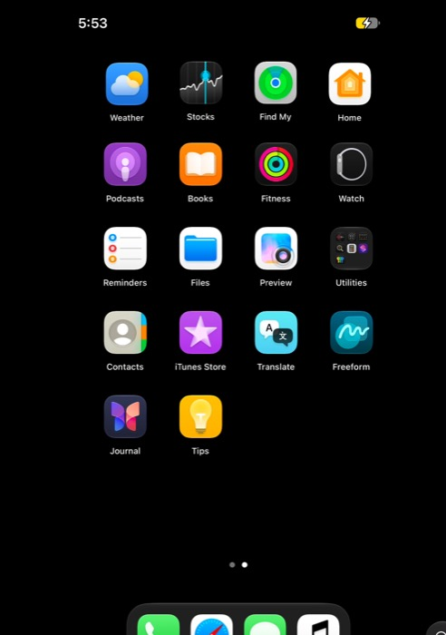
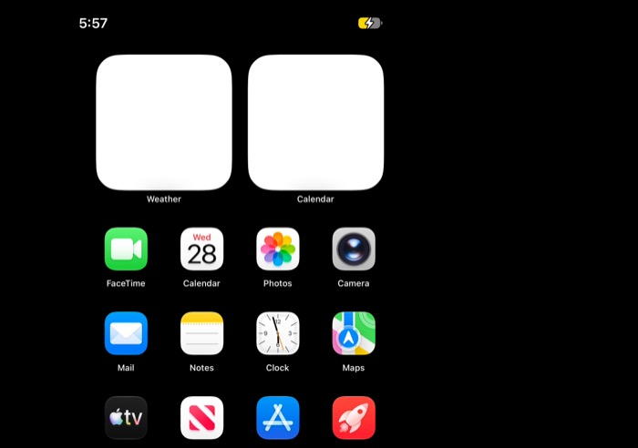
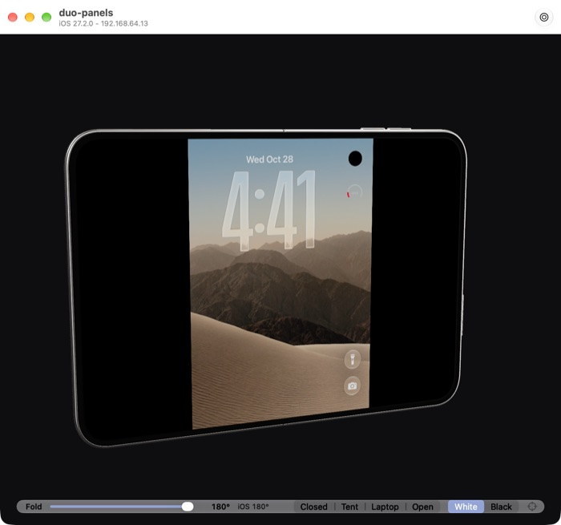
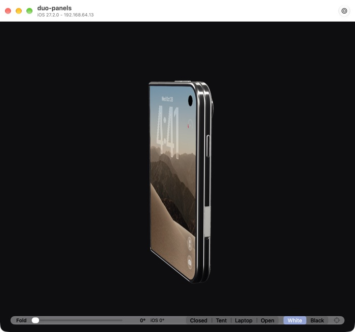
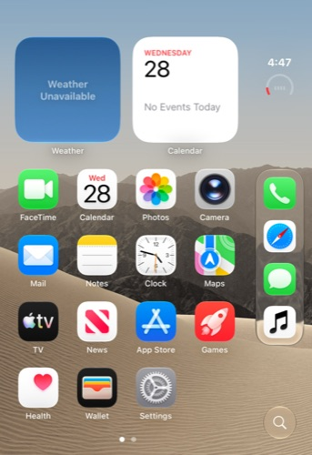

# iPhone Duo: the hinge, the panels and what iOS does with them

Investigated 2026-10-27 on the Duo VM: `iPhone19,4`, board `v68ap`, iOS 27.2
(24B91020), cloudOS 26.4 (23E5207q), host an A18 Pro Mac on macOS 27 with
`hw.optional.arm.FEAT_CSSC = 0`. Static evidence comes from the 27.2 restore
archive and its dyld shared cache; runtime evidence from the guest through
vphoned. Addresses are left out: they are observations of one build, never
constants to patch against.

This continues [iphone_duo_bringup.md](iphone_duo_bringup.md), which got the
Duo's userland to boot on a host without CSSC.

## Summary

| Question | Answer | Evidence |
| --- | --- | --- |
| How does iOS learn the hinge angle? | A HID service, vendor motion page `0xFF0C`, usage `0x21`, sending events of type `0x2C` | dyld cache, below; the virtual service is matched and its events dispatched |
| Can a VM have both panels? | No: one display per VM | `_maximumAllowedDisplayCount` is 1; a second display fails configuration |
| Does SpringBoard switch layouts on one display? | No | screenshots at 0° and 180° are the same outer layout |
| Where do hinge events go in backboardd? | Into its event dispatcher, with no destination | one `destinations for Unknown event: ()` per angle set |
| Does the virtual sensor block rotation? | No | rotation is refused with the sensor cleared too |

## The device tree

`Firmware/all_flash/DeviceTree.v68ap.im4p`, `/product`:

- `artwork-device-subtype = 2034`, `artwork-scale-factor = 3`,
  `app-macho-architecture = arm64e.x1`;
- two children, `display0` (index 0, rotation 0, scale 3) and `display1`
  (index 1, rotation 270, scale 3).

Apple's published panels fill in the sizes: the outer is 1398 × 2034 at
460 ppi, the inner 1878 × 2670 at 430 ppi in its native portrait. Mounted at
270°, the inner panel is landscape when the phone is open, 2670 wide.

## The hinge sensor

### Static: who reads it

In the 27.2 shared cache (relabelled from `arm64e.x1` to plain `arm64e` so the
tools would parse it):

- **HID.framework** exports `IOHIDEventCreateHingeAngleEvent`, whose arguments
  are `(allocator, timestamp, angle, mechanicalAngle, velocity, options)`. It
  builds an event of type `0x2C`.
- **CoreMotion**'s angle notifier, `CLAngleNotifier`, matches services on
  usage page `0xFF0C` (Apple's vendor motion page) and usage `0x21`, and
  reads the angle field of `0x2C` events. It runs in **locationd** (below).
  A `CLLidAngleNotifier` also appears in the cache, a different class not in
  CoreLocation's or CoreMotion's public frameworks.
- **SpringBoardFoundation**'s `SBFDevicePoseProvider` takes that angle and
  turns it into the device pose that decides which panel is in use.
- **SpringBoard** has a continuous-fold controller, `SBContinuousFoldController`,
  with a pair of mappings between the hinge angle and fold progress
  (`…ContinuousFoldAngleProgressForHingeAngleDegrees` and its inverse), and a
  hinge-angle HUD, `SBFHingeAngleHUDView`, behind a `SBShowHingeAngleHUD`
  default.
- **UIKit** carries the hinge state to scenes through
  `_UISceneHingeStateHostComponent`, which is how an app would learn the pose.

### Runtime: the virtual service

`libvphonehinge.dylib` runs in `backboardd` on this product type only and
creates a `HIDVirtualEventService` with that identity. vphoned's
`motion.hinge.get` reports the provider's own view:

```
"provider_running": 1, "enumerated": true, "dispatch_failures": 0,
"dispatched": 35, "configuration": { "angle": 180, ... }
```

The service is enumerated by the HID event system, and every angle set is
dispatched without a failure. Angles read back exactly: 87.5, 33.25, 0 and
180 were each published as set.

### Runtime: backboardd's routing

With the unified log captured from `backboardd` while the angle was set five
times (150°, 60°, 0°, 90°, 180°), `com.apple.BackBoard` logged five lines:

```
destinations for Unknown event: ()
```

and nothing else about them. BackBoard's event delivery receives the events,
does not know the type and has no destination for it. That fits the static
picture: the angle's consumer is CoreMotion, which matches the HID service
itself, not a BackBoard route. A real Duo has the same service, so this line
is probably normal there too; it is recorded here because it is the only
trace the events leave in the log.

Nothing in SpringBoard's or locationd's log at the default level mentioned a
pose or the angle during the capture.

### locationd, where the angle is read

`/usr/libexec/locationd` (27.2, pulled from the guest for reading; not kept in
the repository) holds `CLAngleNotifier` (`Shared/Motion/Notifiers/Angle/
CLAngleNotifier.mm`) and `CLSPUAngleServiceControl`. Its strings show two
separate paths:

- **Events:** `CLAngleNotifier::onIoHidEvent(IOHIDEventRef, bool)`, with
  `copyEvent`, and the assertion `IOHIDEventGetType(event) ==
  kIOHIDEventTypeHingeAngle`. Each event is logged as `phase, state, angle,
  mechanicalAngle, velocity, timestamp` — the fields the virtual service
  fills.
- **The driver:** `openHIDDriverInterfaceIfNeeded` and `sendCommand`, for
  commands to the physical hinge driver. On a VM these are skipped on
  purpose:

  ```
  [CLAngleNotifier] Skipping open for physical HID device on VM/Simulator
  [CLAngleNotifier] sendCommand skipped, no physical HID driver (VM/Simulator)
  [CLAngleNotifier] copyEvent: no HID device available
  ```

So locationd knows it may run in a VM and drops the driver side there. Whether
its event side then takes the virtual service's events is not shown by the
strings; `copyEvent: no HID device available` suggests the copy path, at
least, finds nothing. locationd also carries a `CMAngleSimulator` (start and
end angle, duration, delay, options), and `CLSPUAngleServiceControl`'s
telemetry has an `isSimulated` field: Apple simulates the hinge in its own
tools, from inside the sensor stack.

### Nothing asks for the angle

Across a locationd restart, with the angle set five times afterwards,
locationd logged 4,889 lines and not one from `CLAngleNotifier`, not even its
VM skip. The notifier is made on demand, so on this guest nothing asks for
the angle. The asker would be SpringBoard's pose provider, and its pose says
when it would:

```
devicePose = { orientation, coverOrientation, innerOrientation,
               hinge = { isAvailable, position, state,
                         fullyClosedRegion = { start, end, isActive, … } } }
```

`hinge.isAvailable` gates the rest. What sets it is not in the strings; a
check against the device's displays or a capability is the likely source,
and with `display1` absent it would stay false. The display mode then
follows a resolution policy, among them
`SBFForceCoverDisplayOnlyDisplayContentModeResolutionPolicy` (`resolvedMode
ForDisplayProxy:devicePose:`, `preferredPrimarySurfaceTypeForDevicePose:`):
a Duo shown on its cover display alone, which is what this guest does.

### The hinge-angle HUD

`SBShowHingeAngleHUD = YES` in `com.apple.springboard`, read back as set, and
a SpringBoard restart: no HUD appeared on the outer screen while the angle was
moved (150°, 120°, 90°), screenshot 0.3 s after each change. The HUD is
switched by SpringBoard's debug HUD (`SBWindowSceneDebugHUDWindowRootView
Controller _isHingeAngleHUDEnabled`), not by that default alone, and the pose
provider gets no angle here anyway (above). The default was removed
afterwards.

## One display

`VZMacGraphicsDeviceConfiguration` has a private
`_setDisplayPortCount:` and a class method `+_maximumAllowedDisplayCount`. On
this host the maximum is 1. A configuration with two
`VZMacGraphicsDisplayConfiguration`s fails:

- without changing the port count: *"Number of displays is greater than the
  configured display port count"*;
- with `_setDisplayPortCount:2`: *"The display port count is invalid, it must
  be between 1 and the maximum supported."*

So a VM cannot present `display1`. The window draws both panels from the one
display and lights one at a time.

## What SpringBoard does with the angle on one display

Screenshots of the guest's own framebuffer at 0° and 180°, home screen in
front, show the same outer-panel layout: four columns, the dock as a
vertical strip on the right, 466 × 678 points at 3×. `device.screen` reports
the same size at every angle.

SpringBoard's fold logic chooses a display; with `display1` absent there is
nothing to move to, and it stays on `display0`. Whether it tries and fails, or
never tries without the second framebuffer, is open (see below).

### Rotation

`display.rotation` to 90° is refused on this guest with *"The device did not
apply the requested rotation"*, for the home screen, Settings and Safari, at
0° and 180° of fold, and with the hinge sensor cleared. That is the
orientation gate described in
[springboard_orientation_stuck.md](springboard_orientation_stuck.md), not the
hinge.

## Instruction emulation

The A20 Pro userland uses the CSSC scalar instructions (`ABS`, `CNT`, `CTZ`,
`SMIN`/`SMAX`/`UMIN`/`UMAX`). On a host without `FEAT_CSSC` each one traps to
the guest kernel's fallback. Boot completes; app launches are slower. On this
host, tapping Settings took between 4 and 10 seconds to bring it to the
front.

## Forcing a fold: what was tried

The question: can iOS be made to fold for real, laying out one wide inner
screen when open and the small outer one when closed? Tried on 2026-10-28,
same guest, engine 2.13.8-local.311d9268.

| Attempt | Result |
| --- | --- |
| Two displays in one VM | **Impossible.** `_maximumAllowedDisplayCount` is 1; a second display fails configuration either way (above). |
| Resize the one display live as the hinge moves (`VZGraphicsDisplay.reconfigure(sizeInPixels:)`, the socket's `display` command) | **Refused by Virtualization.framework:** *"Display does not support reconfiguration at this time"*, for 2670 × 1878, 1878 × 2670 and back to 1398 × 2034. Live resizing needs the guest's display driver to take part; macOS guests have one, the iOS guest does not. iOS kept 466 × 678 points throughout. |
| Boot the one display at the inner panel's portrait size, 1878 × 2670 @ 430 ppi | **Boots, 626 × 890 points.** SpringBoard draws a different layout: a top status bar and a horizontal dock, where the outer panel has a side dock. It is not the inner panel's layout done right: the icon grid sits off-centre and the wallpaper is black, as parts of SpringBoard still measure for the outer panel. |
| Boot it at the inner panel as seen open, 2670 × 1878 landscape | **Boots, 890 × 626 points.** SpringBoard lays out its portrait phone screen in a column on the left; the rest is black and the bottom rows are cut off. iOS does not lay out for a wide panel here. |

| Outer size (normal) | Inner size, portrait | Inner size, landscape |
| --- | --- | --- |
|  |  |  |

### Why it cannot be forced on this VM

1. **The VM has one framebuffer and it cannot change size.** That rules out
   both real routes: a second display for the inner panel, and one display
   that changes size as the phone opens.
2. **SpringBoard's inner layout belongs to `display1`, not to a size.** The
   Duo's device tree names two displays, and SpringBoard picks the display,
   and the layout with it, from its device pose. With `display1` absent, the
   pose provider's `hinge.isAvailable` stays off, nothing asks locationd for
   the angle (4,889 log lines, none from `CLAngleNotifier`), and the
   cover-display-only policy applies. A bigger `display0` is still the cover
   display to SpringBoard: it gets the phone layout, stretched or clipped,
   not the inner one.
3. **locationd drops the hinge driver on a VM by design** (`Skipping open
   for physical HID device on VM/Simulator`), so even the angle's own path
   is built to stay quiet here.

### The inner display is not in this VM's device tree

The running guest's device tree (`device.ioreg` with `plane: IODeviceTree`)
has a single virtual `gfx` node, and `product` holds `vphone600-gestalt-
variants`, `maps`, `usb-device`, `util`, `camera`, `facetime`, `audio` and
`iopm`: **no `display0`, no `display1`**. The VM boots vphone's virtual
research board, carrying the Duo's product identity but not its display
nodes; `display1` (index 1, rotation 270) exists only in the restore image's
`DeviceTree.v68ap`. A real Duo gets its inner layout from that node and the
second display controller behind it. Here iOS 27.2 has the layout, and
nothing to put it on.

### Grafting the panels into the VM's tree

`cfw patch-dt-iphone-product --panels` copies `/product/display0` and
`/product/display1` from `DeviceTree.v68ap` into a restored guest's
`devicetree.img4` on Preboot. Off by default; tried on 2026-10-28 on a
copy-on-write clone of the 27.2 Duo guest, never on the original.

**What is copied, and what is not.** The two nodes have no `compatible`, so
no driver matches them: they describe the panels to userland and nothing
else. Everything that drives the panels on a real Duo (the DCPs,
`disp0`/`dispext0`, the display pipes, crossbar and DARTs under `arm-io`)
has a `compatible` and promises silicon the VM does not have, so it stays
out. The board's phandles (470, 471) would collide with the guest's, so the
copies get the next free ones.

| | display0 (outer) | display1 (inner) |
| --- | --- | --- |
| index, rotation, scale | 0, 0°, 3 | 1, 270°, 3 |
| `surface-type` | 1 | 2 |
| corner radii (pt) | 8, 8, 59, 59 | 55 on each corner |
| special region 0 | `Jindo`, 111 px circle at (1199, 88) | `BlankableRR`, 111 px at (63, 710) |
| special region 1 | none | `Fold`, a line 1878 px wide at y = 1335 |
| `has-prox` | 1 | 0 |

The `Fold` region is the crease: y = 1335 is the middle of the inner
panel's 2670 rows. Each node also carries its own button and camera
geometry and a `chrome-identifier` (`phone15` outer, `phone14` inner).

**The tree.** 151 nodes become 153, the payload grows from 73,504 to 75,676
bytes (the two nodes are 1,036 and 1,136), every phandle stays unique, and
a strict walk of the flat tree ends on its last byte. `ipsw dtree` cannot
parse the restored tree before the graft or after it ("unexpected EOF"), so
the walk is our own.

**Booting it.** iBoot and the kernel take the tree; iOS boots to the Lock
Screen. `device.ioreg` with `plane: IODeviceTree` lists `display0` and
`display1` under `product`. The hinge works as before: 87.5°, 0° and 180°
read back exactly, and the window shows each as iOS's angle.

What iOS does with them: on the second boot with the graft, the Lock
Screen has a black circle at the top right, open and closed, at the place
and size `display0` gives its `Jindo` region (111 px at 1199, 88 of the
1398-wide panel, about 92% across and 6% down). The same clone on its
original tree has none: only the clock and the battery ring there.

| Panels, open | Panels, closed | Original tree (iOS's own screenshot) |
| --- | --- | --- |
|  |  |  |
 The guest display is still 466 × 678 points at 3×, the
outer panel's; SpringBoard draws no inner layout. So userland reads the
nodes, but a second panel is not enough to make it use one: the display it
lays out on is still the one framebuffer, whose identity is the outer's.

**Reliability.** Six boots of the clone with the graft, two without:

| Tree | Boots | Agent connected | Hinge (3 angles) |
| --- | --- | --- | --- |
| With panels | 1st | no, in 8 minutes; black band on the Lock Screen | not reachable |
| With panels | 2nd to 5th | each, after 42 to 76 s | 3 of 3 each time |
| Original | 2 | each, after about 25 s | 3 of 3 |

The one failure was the clone's first boot ever, straight after an AMFI
refusal; every boot since has been normal. The graft looks safe, but one
unexplained failure is why `--panels` stays off by default for now.

**Which panel iOS lays out for.** SpringBoard asks MobileGestalt about each
display by index ("Invalid data found for display-indexed MG query at index
%ld; falling back to legacy query" in SpringBoard), and
`AppleEmbeddedDisplayServices` reads a `display-index` property, so the VM's
framebuffer, which has none, is display 0: the outer panel. Giving the
framebuffer node (`/arm-io/gfx`) `display-index = 1` does not make it the
inner panel: iOS boots to a black screen, still 466 × 678 points, and the
guest agent drops once. The index alone is not the switch; what else
`AppleEmbeddedDisplayServices` matches on (the framebuffer's own properties,
its size, `framebuffer-identifier`) is the next thing to read.

**Why the inner display is black.** SpringBoard's own log (category
`DisplayContentMode`, captured with `logs.syslog`) shows it, with the panels
grafted, `display-index = 1` and the inner size:

```
DCMResolved: FullyClosed→FoldingDual | legacyMain: target pri→aux, resolved pri→aux
DCMPose: 180.0° (1.00 fold:1.00): openFlat
COMPLETED:     .cover:aux | 180.0° (1.00 fold:1.00): openFlat
[Auxiliary Content] keeping .cover inactive for .passiveShield
```

and folded, `COMPLETED: .cover:pri … fullyClosed`. The pose works: folding
and unfolding switch the policy between FullyClosed and FoldingDual.
SpringBoard calls the one display (`CADisplay` "LCD primary", the
`mainDisplay` scene) the `.cover` surface whatever its `display-index`. Open
flat, it gives `.cover` auxiliary content (a passive shield, backlight off)
and moves primary content to an `.inner` surface that does not exist.

The surface comes from `SBFDisplayProxy` (`coverIntegratedDisplayWithIdentifier:`,
`innerIntegratedDisplayWithIdentifier:`, `defaultIntegratedDisplayWithIdentifier:`)
and `-[SBFDisplayContentModeResolver _surfaceTypeForWindowScene:]`. What that
method keys on, the display's identifier or something per display, is the
next thing to read: making the one display `.inner` while open is what the
inner layout needs.

### What decides the layout iOS draws

Measured on 2026-10-28 against the 27.2 shared cache and the clone.

**SpringBoard picks a content mode, not a size.**
SpringBoardFoundation resolves the display content mode through policies:
- `SBFSingleIntegratedDisplayContentModeResolutionPolicy`;
- `SBFFoldingDualDisplayContentModeResolutionPolicy`;
- `SBFForceCoverDisplayOnlyDisplayContentModeResolutionPolicy`;
- `SBFFullyClosedDisplayContentModeResolutionPolicy`;
- `SBFTentModeDisplayContentModeResolutionPolicy`;
- `SBFYoinkDisplayContentModeResolutionPolicy`.

Their input is `SBFDevicePoseProvider`'s pose. Its type encoding names every field:
- the orientation for each panel;
- `hinge` (`isAvailable`, `position`, `state`, the fully closed, closed,
  partially open and open-flat regions, the transition progress);
- `uiHingeStatus`;
- `cmAngle` and `cmMagicPose`, CoreMotion's angle and posture.

**The framebuffer is display 0.** SpringBoard queries MobileGestalt per display
index ("display-indexed MG query"), and `AppleEmbeddedDisplayServices` reads a
`display-index`. The VM's framebuffer has none, so it is display 0, the
outer panel. Marking `/arm-io/gfx` with `display-index = 1` is honoured:

| Framebuffer | Panels in the tree | Result |
| --- | --- | --- |
| 1398 × 2034 (outer), no index | yes | the outer layout, as always |
| 1398 × 2034, `display-index = 1` | yes | black screen, 466 × 678 pt |
| 1878 × 2670 (inner), `display-index = 1` | yes | black screen, 626 × 890 pt |

iOS treats the screen as the inner panel, then keeps it dark. With no
hinge, the pose provider leaves the cover-display-only policy in force, and
the inner display has no content.

**Why there is no hinge.** CoreMotion, inside locationd, opens the hinge
sensor only when MobileGestalt says the device is neither virtual
(`IsVirtualDevice`) nor a simulator (`IsSimulator`), and logs "Skipping
open for physical HID device on VM/Simulator" otherwise. This is deliberate
on Apple's side, and this project leaves it so: making iOS believe it is not
a VM is out of scope.

**Not a route here: `CMAngleSimulator`.** locationd's `CMAngleSimulator`
(start and end angle, duration, delay, options) is a command for the sensor
processor's firmware (`CLSPUAngleServiceControl`). The VM has no sensor
processor.

**The route that remains: SpringBoard's test automation.**
`SBSTestAutomationService` (SpringBoardServices) has `getDevicePose` and
`setDevicePoseOverride:`. They take `{long long; int; int; int}`.
SpringBoard's handler, `-[SBTestAutomationService
systemServiceServer:client:setDevicePoseOverride:]`, registers a pose
transformer named "Test Automation" that rewrites the computed pose:
- The first field becomes `orientation`.
- The three ints build a CoreMotion magic pose (device orientation, hinge
  state, tabletop pose), stored into `cmMagicPose` and marked available.
- The hinge state, when below 5, also selects a canned `cmAngle` from
  {0°, 0°, 90°, 180°, 180°} and marks it available.

The service is entitled by `com.apple.springboard.testautomation`, the test
tools' entitlement. The script bridge cannot pass the struct (`Return values
of type '{?=qiii}' are not supported`), so the caller is native:
vphoned's `display.pose.get` and `display.pose.set` (capability
`display_pose`), holding that entitlement. The Duo window sends the hinge
state each time the fold crosses one: 1 below 30°, 2 below 150°, 4 from there.

Measured on the clone, 2026-10-29:

| Tree and framebuffer | Pose | Result |
| --- | --- | --- |
| stock tree, 1398 × 2034 | 4 (open), then 1 (closed) | SpringBoard reads each back; the outer layout either way |
| panels grafted, `display-index = 1`, 1878 × 2670 | 4, and 1 → 2 → 3 → 4 again | SpringBoard reads each back and runs, no crash; the screen stays black |

So the pose reaches SpringBoard, and the black inner display is not for want
of a hinge. SpringBoard has one display and still gives the inner panel no
content: what it lacks is the second display itself, or whatever its display
arbitration matches on to put content there. That arbitration is the next
thing to read.

### What could change it

- A Virtualization.framework that allows two displays, or live resizing of
  an iOS guest's display.
- Answering `display1` from the one display in the guest: the
  `display0`/`display1` nodes are now in the tree (above); what is left is
  making SpringBoard route the inner one to the framebuffer, swapping by
  pose. That needs SpringBoard's display arbitration and the framebuffer's
  identity, neither yet mapped, and is the one route that does not wait on
  Apple.

The 3D window already does the host's half: it lights the panel the fold
selects and shows iOS there; what is missing is iOS changing its layout.

## The 3D model, for whoever works on it next

`DuoModel.usdz` as RealityKit loads it:

- The halves are `half_back` and `half_front`. `half_back` rests turned 180°
  about Y; a fold must compose with that rest pose, not replace it.
- The spine runs along the scene's Y axis; the outer display faces +Z and the
  inner −Z when the phone lies open.
- The inner display is not a mesh of its own: it is material slot 0
  (part `Plane_038`) of the skinned `hinge_rig`, 26 joints, two influences per
  vertex. Its bind pose equals its rest pose, yet its vertices, measured in
  the entity's space, come out mirrored across the panel from where they are
  drawn. A screen is never seen mirrored, so the mapping is checked with
  `u × v` against the panel's outward normal and reflected back when it
  disagrees.
- Emissive textures on `PhysicallyBasedMaterial` showed a flat colour on
  this host; an `UnlitMaterial` shows the frame, and is what a screen should
  be anyway.
- The exported scene lost its button hit zones (they were hidden in Blender
  and USD export skipped them); the app builds zones from the key meshes.

## Open questions

- **Does SpringBoard try to switch to `display1`?** Its fold transition and
  the pose provider's decision would show at the debug log level, or with a
  breakpoint on the pose provider's update path.
- **What sets `hinge.isAvailable`?** Finding it in SpringBoardFoundation's
  pose provider is the next step. Once it is true, the provider asks
  locationd for the angle, and whether `CLAngleNotifier`'s event path takes
  the virtual service's events (or needs `CMAngleSimulator`) can be seen.
- **Could one framebuffer stand in for both?** Answering `display1`'s
  geometry from the one VM display, and switching what it shows by pose, is
  the path to a guest that relays out on unfold. It needs SpringBoard's
  display arbitration and the framebuffer's identity, both unexplored.
